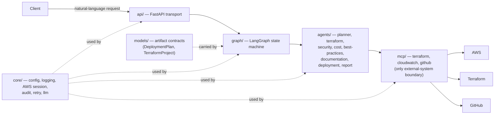
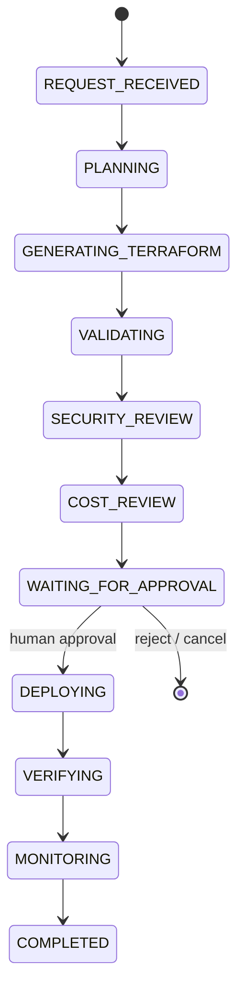

# Architecture

CloudPilot turns natural-language requests into reviewed AWS infrastructure
deployments. This document describes the intended architecture and marks
precisely what is **built** versus **planned**. The authoritative backlog is
[`tasks/000-tasks-list.md`](../tasks/000-tasks-list.md).

## System overview

Agents reach external systems only through MCP servers, never directly —
which is what makes "never execute shell for Terraform" enforceable rather
than aspirational.



Nothing mutates AWS until a human approves. Hard rules (approval gating,
append-only audit trail, credential discipline) live in
[`AGENTS.md`](../AGENTS.md) and are enforced by code boundaries, not prompts.

## Deployment state machine

Each request advances through a gated state machine (Tasks 008/009 built the
skeleton — one stub node per status, linear edges; the reject/cancel branch
and real node logic arrive with Phases 5–7). The serving compile (Task 011)
pauses every run at `WAITING_FOR_APPROVAL` via a checkpointer, so approval
is what resumes it. Task 010's API layer exposes endpoints to submit a
deployment and to get status/approve/reject/cancel by calling the graph's
 gate operations (start_run, get_run, record_decision, approve_run). No
AuthN/AuthZ or rate limiting is in scope for Task 010.



`apply` and `destroy` are approval-gated: Phase 6 (governance) must exist
before Phase 7 (deployment) can mutate anything.

## Package layout and import direction

```
src/cloudpilot/
├── agents/    planner, terraform, security, cost, best-practices,
│              documentation, deployment, report
├── graph/     LangGraph state machine and its nodes
├── mcp/       external-provider boundary: terraform, cloudwatch, github
├── api/       FastAPI transport
├── models/    artifact contracts (DeploymentPlan, TerraformProject)
└── core/      cross-cutting: config, logging, AWS session, audit, retry, llm
```

Dependencies flow one way (`models/` is a leaf; `api/` is transport only).
The full table is in the [README](../README.md#import-direction), and it is
**enforced** by `tests/test_import_direction.py`, an AST check that fails
the test suite on any inverted import.

## What is built versus planned

| Component | Status |
|---|---|
| `core/logging.py` — JSON/human logging, secret redaction, log context | **Built** (Task 003) |
| `core/config.py` — typed `Settings`, `CLOUDPILOT_` env prefix | **Built** (Task 004) |
| `core/aws.py` — session factory: ambient or STS assumed role | **Built** (Task 007) |
| `api/app.py` — app factory + `GET /health` only | **Minimal** (Task 006); full API is Task 010 |
| `api/routes.py` — FastAPI endpoints wired to LangGraph gate ops | **Built** (Task 010) |
| Container + compose stack (app, Postgres checkpoint DB) | **Built** (Task 006); as of Task 012 the checkpointer uses SQLite for local dev — the compose Postgres is unused pending a production-backend decision (follow-up) |
| `graph/state.py` — `DeploymentStatus` machine + `DeploymentState` contract | **Built** (Task 008) |
| `graph/graph.py` — compiled StateGraph, one stub node per status | **Built** (Task 009); real node logic is Phases 3–7 |
| `graph/persistence.py` — checkpointer factory (memory or SQLite) + gate-paused serving compile | **Built** (Tasks 011/012) |
| `agents/`, `mcp/`, remaining `core/`, `models/` | **Planned** (Phases 3–9) |

## External boundaries (planned)

| MCP server | Capability | Gate |
|---|---|---|
| `terraform` (Task 019) | init, validate, fmt, plan, apply, destroy | `apply`/`destroy` approval-gated; never via direct shell |
| `cloudwatch` (Task 039) | logs, metrics, alarms, health | read-only |
| `github` (Task 044) | commit, PR, comment, review | approval-gated merge |

## Documentation conventions

- `docs/` is hand-written markdown; diagrams are Mermaid in-code, rendered
  by GitHub — no diagram tooling or binary assets to keep in sync.
- Generated API reference (sphinx/mkdocstrings) is **deliberately not
  used** until there is a stable public API or a release to attach it to;
  docstrings are the source of truth until then.
- Rationale for individual decisions lives in the per-task git history
  (`git log` — each task has its own explanatory commit) and in the task
  files' acceptance criteria.
- `specs/` is vendored from the AI Engineering Toolkit and read-only; it
  is engineering criteria, not CloudPilot documentation.
